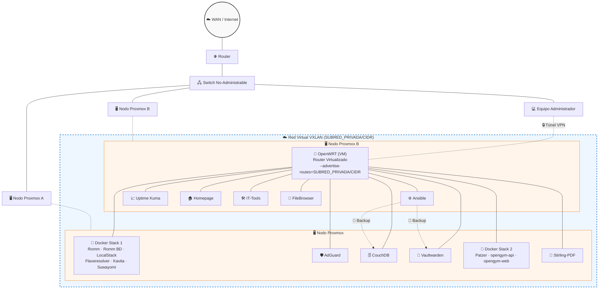

# Arquitectura de Red y Virtualización (Homelab)

Este documento describe la topología de red, la infraestructura física y el entorno virtualizado desplegado sobre Proxmox VE, utilizando redes definidas por software (VXLAN) y acceso remoto seguro mediante VPN.

## Diagrama de Arquitectura

A continuación se muestra una representación lógica y física de la infraestructura utilizando Mermaid:

## Componentes de la Infraestructura

### 1. Capa Física y Acceso a Internet

* **WAN y router:** Punto de entrada y salida hacia Internet. Gestiona la conexión del proveedor de servicios y realiza el NAT inicial hacia la red local.
* **Switch No-Administrable:** Dispositivo de capa 2 que interconecta los equipos físicos (Nodos Proxmox y el equipo del Administrador) con el router principal sin necesidad de configuración de VLANs físicas en el hardware.
* **Equipo Administrador:** Estación de trabajo desde la cual se gestiona la infraestructura. Aunque está conectada físicamente al mismo switch, utiliza un túnel VPN para alcanzar directamente las subredes internas aisladas.

### 2. Capa de Virtualización (Clúster Proxmox)

La infraestructura de cómputo se divide en dos servidores físicos ejecutando Proxmox VE:

* **Nodo Proxmox A:** Aloja cargas de trabajo y almacenamiento compartido.
* **Nodo Proxmox B:** Aloja servicios de enrutamiento virtual y proporciona redundancia/distribución de recursos.

### 3. Red Virtual (SDN - VXLAN)

Para aislar el tráfico de los servicios internos de la red física doméstica (y evitar depender de un switch administrable), se utiliza una red superpuesta (*Overlay Network*):

* **Subred VXLAN (`SUBRED_PRIVADA/CIDR`):** Extiende una red de capa 2 sobre la red física de capa 3 entre ambos nodos Proxmox, permitiendo que las máquinas virtuales se comuniquen como si estuvieran en el mismo switch físico. Sustituye el marcador por la subred que configures localmente.
